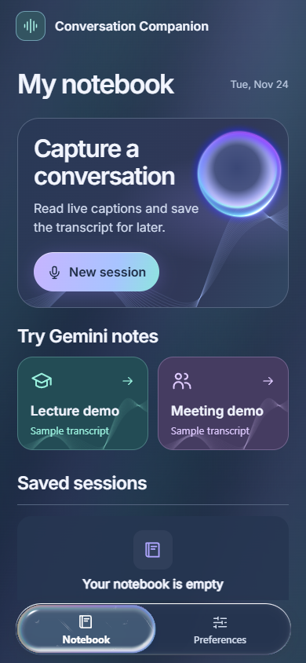

# Conversation Companion

An accessible live-caption notebook for lectures and meetings. Start with everyone's consent, read speech as it arrives, then stop and save the transcript on your device. Connect the optional local AI service to generate notes and ask questions with supporting excerpts.



## Run the app

Install **Node.js 24 LTS** (24.3 or newer), Git, and the native tools for your target. These commands work in PowerShell, Terminal and other standard shells.

```sh
git clone https://github.com/Sinammon/conversation-companion.git
cd conversation-companion
npm ci
```

| Target | First run |
| --- | --- |
| Android on Windows or Mac | Install Android Studio, the SDK, and a JDK using the [Expo environment guide](https://docs.expo.dev/get-started/set-up-your-environment/). Connect a USB-debugging phone or start an emulator with Google speech services. Run `npm run android -- --device`. |
| iOS on Mac | Install Xcode, command-line tools and CocoaPods. Connect an iPhone, enable Developer Mode, and run `npm run ios -- --device`. Select your development signing team when prompted. |
| iOS from Windows | Develop the shared TypeScript code locally. For a signed iPhone development build, use an Expo account and Apple device-signing credentials, then run `npx eas-cli@latest build:configure` and `npx eas-cli@latest build --platform ios --profile development`. Install the build on the registered device. [Expo development builds](https://docs.expo.dev/develop/development-builds/create-a-build/) |
| Browser on Windows or Mac | Run `npm run web` and open the localhost link. Microphone support depends on the browser's Web Speech API and speech service. Chrome is suitable for trying the interface. Browser sessions use local storage. |

For a standalone preview on an ARM64 Android phone, download the APK artifact from a successful [Build Android preview run](https://github.com/Sinammon/conversation-companion/actions/workflows/android-preview.yml), unzip it, and open the APK on your phone. This preview uses Expo's generated development signing key and bundles the JavaScript so Metro is unnecessary. A maintainer can run the workflow with a notes-service URL to enable AI for that build. The URL becomes public. Store releases require your own signing credentials.

After installing a development build, run `npm start` and open its Metro link. Rebuild after changing a native plugin, app permission, or Android HTTP transport setting. The speech module requires a development build on phones. Expo Go lacks that module.

Rebuild a development client made before the native Liquid Glass update. The native dock uses Expo's glass effect on supported iOS 26 builds, with a solid surface on Android and when Reduce Transparency is enabled. The browser dock uses the Waterline WebGL effect with a CSS fallback.

For an existing generated Android project, run `npx expo prebuild --platform android` before rebuilding to apply changed app configuration.

### First session

1. Tap **New session**, give it an optional title, and choose **Lecture** or **Meeting**.
2. Get agreement from everyone, check the consent box, and tap **Start live captions**. Grant microphone and speech permissions when prompted.
3. Read the interim text as it settles into the transcript. **Pause auto-scroll** lets you read an earlier passage. If recognition stops, the app shows **Microphone off** and offers **Resume captions**.
4. Use **Caption size** in the live reader or **Preferences** to adjust live and saved captions. Tap **Stop microphone**, then **Save session**. Reopen it from **My notebook**.

**Choose microphone** appears in desktop Chrome 135+ on localhost or HTTPS, and in a rebuilt native iPhone app. Allow microphone access to list inputs before starting, or change the input after stopping and before resuming. If a selected mic disconnects, your current captions stay available and you can select a new input or **System default**. iPhone Safari, Android, and the plain-HTTP Wi-Fi URL follow the system microphone.

Rebuild the iOS development client to add the mic picker. The pinned Expo speech-recognition package is patched automatically by `npm ci`. Desktop Chrome can use the picker after reloading the Expo web app at `http://localhost:8081`.

If iPhone Safari says speech recognition is unavailable, turn on Siri under **Settings → Siri** or **Apple Intelligence & Siri**, then reload the app page in Safari. Tap **Allow** if prompted for microphone access. Safari uses the device's speech recognizer for captions. [WebKit speech recognition](https://webkit.org/blog/11648/new-webkit-features-in-safari-14-1/#web-speech-api)

## Connect AI notes and Q&A

Create an API key in [Google AI Studio](https://aistudio.google.com/apikey). Copy `.env.example` to `.env` if you don't already have one. Add the key to `GEMINI_API_KEY` in that private file on your PC. The server defaults to `gemini-3.1-flash-lite`. Google may use free-tier inputs to improve its products. Get agreement from the participants before sharing a saved transcript with Google. [Gemini pricing and data use](https://ai.google.dev/gemini-api/docs/pricing)

Choose an address reachable **from the phone** before building the app.

| Connection | Values in `.env` |
| --- | --- |
| Local browser or iOS simulator | `EXPO_PUBLIC_AI_URL=http://localhost:8787` and `HOST=127.0.0.1` |
| Android phone over USB | Same values. Run `adb reverse tcp:8787 tcp:8787` while the phone is connected. |
| Android Studio emulator | `EXPO_PUBLIC_AI_URL=http://10.0.2.2:8787` and `HOST=127.0.0.1` |
| Physical phone on trusted Wi-Fi | Set `HOST` to the PC's LAN IP and `EXPO_PUBLIC_AI_URL` to that address with port 8787. For example, set `HOST=192.168.1.20` and `EXPO_PUBLIC_AI_URL=http://192.168.1.20:8787`. Set `WEB_ORIGINS=http://localhost:8081,http://192.168.1.20:8081` so both desktop and phone browsers work. Use the address and port Expo prints. |

Run `npm run server` in one terminal and `npm run web -- --lan` in another. Allow Node through the PC's firewall on the trusted network. The PC and phone must be on the same Wi-Fi. Open the Expo LAN URL on the phone and keep the PC running. Android development builds using local HTTP must be built with that URL configured. The app receives only the service URL. The Node server sends the key to Google.

If `npm run server` reports `EADDRINUSE`, open `/health` at the address it prints. If the existing notes server is ready, use it. After editing `.env`, stop the existing server with Ctrl+C in its terminal and start it again. For `EADDRNOTAVAIL` or `ENOTFOUND`, update `HOST` to the PC’s current Wi-Fi IP or use `127.0.0.1` for local testing. If the IP changed, update `EXPO_PUBLIC_AI_URL` and `WEB_ORIGINS` too, then restart the server and Expo.

Open the service address with `/health` appended in Safari to check connectivity. `missing-key` means the running server could not load a key. `ready` means the key is configured. Generate demo notes to verify that Google accepts it. For a browser running on another origin, add its exact scheme, host and port to `WEB_ORIGINS` and restart the server.

Open a saved session and choose **Notes → Allow sharing with Google Gemini → Generate notes**. In **Ask**, type a question and tap **Ask question**. Approving sharing does not send content until you request notes or an answer. **Lecture demo** and **Meeting demo** are available to try the same features without recording. The service checks excerpts against the transcript and can return an insufficient-evidence answer.

## Data and device behavior

- Captions use the configured system speech recognizer in US English. The recognizer may send audio to its provider. This app disables audio-file persistence. Availability, accuracy, and session length depend on the device, locale and service. Android 12 and earlier can end recognition after each utterance.
- Recording stops when the app enters the background. Save before closing the app. Unsaved capture is held in memory.
- Native sessions and preferences are stored in local SQLite in the app sandbox. Device backup policies may apply. Delete a session from its transcript view. The repository does not sync classmates' notes.
- Each session requires approval for the configured service address and Google Gemini. The server sends the transcript and, for Ask, the submitted question to Gemini. The app keeps captions and saved notes readable when AI is unavailable.

## Develop together

Fork this public repository, create a branch with `git switch -c feature/your-change`, commit focused changes, and open a pull request into `main`. Collaborators with write access can use a branch in this repository. Use `npm ci` to reproduce the lockfile.

```sh
npm run typecheck
npm test
npx expo install --check
npx expo export --platform all
npx playwright install chromium
npx playwright test
```

GitHub Actions runs these checks on pushes and pull requests. Browser tests inject synthetic speech events and service tests inject Gemini responses. These fixtures live under `tests/`. To verify the real hardware and model, use the [device test procedure](docs/device-check.md).

The **Real model smoke test** workflow uses a GitHub Actions secret named `GEMINI_API_KEY`. To check notes and typed questions on invented transcripts using your local key, run `node --env-file=.env --test tests/model/gemini.smoke.mjs`.

The app entry is `App.tsx`. Shared controls live in `src/components`, views in `src/screens`, speech lifecycle in `src/capture`, and persistence in `src/storage`. The mobile AI client lives in `src/ai` and calls the separate Node service in `server/`. The [technical plan](docs/superpowers/plans/2026-11-23-conversation-companion.md) covers speech costs, decisions, and testing.

### Web navbar and component setup

The browser entry for the dock is `src/components/liquid-navbar.web.tsx`. It maps Notebook and Preferences to Guglielmo Giannattasio's Waterline component in `src/components/ui/liquid-glass-navbar.web.tsx`. The imported component uses React, TypeScript, co-located CSS, and the browser's WebGL API. Shared Expo controls use React Native styles in `src/components/ui.tsx`. The `src/components/ui/` directory groups reusable browser UI where a shadcn-style `@/components/ui` alias would point. [Original Waterline component](https://dev.21st.dev/%40gughigug/components/liquid-glass-navbar) · [MIT notice](src/components/ui/liquid-glass-navbar.LICENSE)

The Expo project already has TypeScript. Waterline supplies its own styles and installs no Tailwind or shadcn dependencies. To use shadcn in a separate web host, scaffold a React + TypeScript Vite app with `npm create vite@latest web -- --template react-ts`. In that project, install `tailwindcss` and `@tailwindcss/vite`, add the Tailwind Vite plugin and `@import "tailwindcss";` to the main stylesheet, and map `@/*` to `src/*` in TypeScript and Vite. Then run `npx shadcn@latest init`. [shadcn Vite setup](https://ui.shadcn.com/docs/installation/vite)
